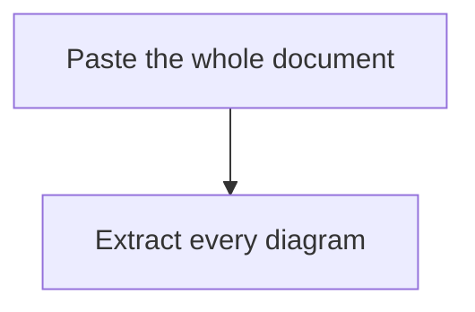

# xmermaid Live

[English](README.md) | [简体中文](README.zh-CN.md)

[](https://github.com/evangwt/xmermaid-live/actions/workflows/deploy-pages.yml)
[](https://evangwt.github.io/xmermaid-live/)
[](https://www.npmjs.com/package/@evangwt/xmermaid)
[](LICENSE)

> **Paste the whole document. Get every diagram — not one you had to find yourself.**

xmermaid Live automatically extracts **all** the Mermaid diagrams from a document in a single pass — fenced, unclosed, or bare in prose — then renders each one live so you can edit, export, or share it. No account, no server, no upload.


<p>
  <a href="https://evangwt.github.io/xmermaid-live/"><strong>Open the live editor →</strong></a>
  &nbsp;|&nbsp;
  <a href="https://github.com/evangwt/xmermaid"><strong>Explore the renderer</strong></a>
</p>

---

## The difference: whole document in, every diagram out

Most Mermaid tools are a **single-diagram paste box**. You scroll your text, find one diagram, copy it, paste it, render it — then repeat, by hand, for the next one. If the block isn't clean, it fails.

xmermaid Live works the other way around. You paste the **entire** document once. It finds every diagram on its own, lists them, and lets you move between them.


| | A single-diagram paste editor | **xmermaid Live** |
|---|---|---|
| **Input** | One diagram you found and copied yourself | The whole document, pasted once |
| **Extraction** | Manual, one at a time | Automatic — every diagram in one pass |
| **Fences** | Needs a clean ```` ```mermaid ```` block | Tolerates unclosed, `~~~`, info strings, and neutral fences |
| **No fence at all** | Fails | Recognized bare in prose |
| **After rendering** | Copy the next one and repeat | Switch diagrams in a list; edit each one in place |
| **When a diagram breaks** | Blank canvas, no explanation | Per-diagram status, diagnostics, and copyable reproduction source |

A real paste — two diagrams, one fenced and one not — is recognized as two diagrams, in source order, without you touching either:

````markdown
Here's the flow:



And the same pipeline drawn bare, with no fence:

flowchart LR
  Extract --> Preview --> Export
````

## What it recognizes

Recognition runs on top of the renderer's strict extractor and is deliberately permissive, because pasted content rarely arrives inside a well-formed fence. It scans on every keystroke and is linear; past 100,000 characters it re-scans once typing pauses instead.

| Form | Example |
|---|---|
| Exact diagram fence | ```` ```mermaid ```` / ```` ```xmermaid ```` / ```` ```mmd ```` |
| Tilde fence | `~~~mermaid` |
| Fence with an info string | ```` ```mermaid {highlight: "1-2"} ```` |
| **Unclosed fence** | ```` ```mermaid ```` with no closing line (runs to the end) |
| Neutral fence holding a diagram | ```` ```text ```` / ```` ```md ```` / ```` ``` ```` |
| **Bare diagram in prose** | A `flowchart TD` line mid-paragraph, no fence |
| **Diagram inside a blockquote** | A diagram quoted with `>` markers, as it arrives when someone quotes a chat answer |
| `%%` comments and one front-matter block | Attached to the diagram above them |
| Multiple diagrams | Separated by prose, back-to-back, or mixed fenced/unfenced — kept in source order |
| **Several diagrams in one fence** | A single ```` ```mermaid ```` block holding two diagrams is split at each column-zero header, so both render instead of the whole block failing as one |

It also knows what to **leave alone**: a diagram-looking line inside a ```` ```js ```` block stays code, and prose that merely resembles diagram syntax (a figure caption, `Title: …`, a bullet list, a line opening with an edge operator like `-> see the appendix`) ends a bare block instead of being swallowed. Splitting a fence is deliberately conservative — a boundary must be a column-zero header with no edge operator (so a node named `sequenceDiagram` written as `sequenceDiagram --> B` stays a node), and if any piece would be a lone line the fence is left whole. The deliberate limits are documented and covered by tests in [`src/diagram-extract.ts`](src/diagram-extract.ts).

**Capacity:** pasting and extracting a 1,000-diagram document completes in under 1.5 seconds on the verification environment (an end-to-end test enforces it). This is not an incremental parser — the cost tracks diagram count at roughly 0.1 ms per diagram, so a diagram-dense megabyte (some 15,000 diagrams) takes several seconds while prose-heavy text is far cheaper — so documents past 100,000 characters are re-extracted once typing pauses instead of on every keystroke, whether you edit the full text or just the current diagram (editing one diagram splices the text immediately and defers the re-scan). The text and the live preview keep up on the keystroke; the diagram list, its count, and the mixed reading view catch up when that deferred scan lands.

## A multi-diagram workbench, not a single canvas

Extraction is only useful if the workspace treats the document as many diagrams. It does:

- **Diagram list** — every extracted diagram as a selectable item showing its index, family, support status, and source line. Collapsible; the count sits in the header.
- **Two editors, one document** — switch between **Full text** (the whole document, Markdown-highlighted) and **Current diagram** (just the selected one, Mermaid-highlighted). Editing the current diagram rewrites only that diagram's range in the document, leaving the surrounding prose untouched.
- **Mixed document preview** — a third tab reads the whole document in order: prose as formatted text and every diagram rendered inline where it appeared. Diagrams render lazily as they scroll into view, so a long document stays light.
- **Previous / next navigation** — step through diagrams with a `n / total` position readout, without returning to the list.
- **Selection that stays put** — while you edit, the selected diagram is tracked by matching content, so the preview doesn't jump to a different diagram under your cursor.
- **Per-diagram output** — export SVG/PNG, share, and copy reproduction source apply to the diagram you have selected.

On first visit the workbench opens preloaded with a **33-diagram sample document** — one diagram per supported family, drawn entirely by its own renderer, including one deliberately fence-less diagram to demonstrate bare extraction.

## Honest, per diagram

Every diagram carries its real support status, and failures explain themselves instead of showing a blank canvas:

- The list and diagnostics bar report the actual capability for the **selected** diagram.
- Diagnostics carry codes, messages, and source ranges; unsupported syntax is surfaced, never silently downgraded to a fake preview.
- **Copy reproduction source** puts the exact diagram source on your clipboard, ready for an issue.
- Export stays disabled until the rendered snapshot matches the current source *and* theme — a stale SVG is never handed back as a new result.

## Preview and style

- **Canvas controls** — zoom 25%–400%, fit, fullscreen, maximize-panel, a minimap, wheel-zoom at the pointer, and drag-to-pan. Each diagram's viewport is remembered separately; zoom and pan never enter share links.
- **Style inspector** — restyle the selected diagram without editing its source: base theme (dark/light), the full color set (background, node fill/stroke/text, edge stroke/label, arrow fill, subgraph fill/stroke), curve style (bezier/step/straight), arrow style (filled/triangle/open/circle/cross), geometry (edge gap, arrow size, node border radius), and font family/size. One click resets.
- **Layout your way** — three panes with draggable dividers, keyboard adjustment, and a collapsible list; your layout is saved locally. Below 1024px the workbench switches to bottom navigation, with share and export under **More**.

## Dark theme

The workbench ships in both themes. It follows your system preference on first visit, remembers what you pick, and the switch flips the **whole** workspace at once — chrome, syntax highlighting, the diagram list, and the rendered diagram itself, which re-renders to match.


## Private by architecture

Client-side only. Your document is cached in local storage (capped at 2 MB, debounced writes) and optionally encoded into the URL hash for sharing — **never uploaded to this project or any server**. Sharing is capped at a 50,000-character hash; longer documents stay editable and exportable but don't enter the address bar. Export runs in WASM with no network call. Clear the site's browser data to remove the cache.

## Who it's for

- **Developers and writers** pasting AI-generated diagrams into docs — several at a time, in messy syntax.
- **Anyone reviewing a chat log** where the diagrams aren't neatly fenced.
- **Privacy-conscious users** who can't upload internal architecture to a third-party service.
- **Teams publishing static docs** who need clean SVG/PNG output and shareable links.

## Quick start

### Try it in 30 seconds (no install)

1. Open **[evangwt.github.io/xmermaid-live](https://evangwt.github.io/xmermaid-live/)**.
2. Paste a whole document — a chat answer, a README, a design doc. Don't extract anything by hand.
3. Every diagram appears in the list on the left. Click one to preview, edit, and export.

### Run it locally

Requires **Node.js 22+**.

```bash
git clone https://github.com/evangwt/xmermaid-live.git
cd xmermaid-live
npm install
npm run dev
```

Vite prints a local URL (usually `http://localhost:5173`) — the same workbench as the hosted demo. `npm run dev` copies the pinned WASM module into `public/` automatically; no Rust toolchain is needed.

## Diagram examples

Twelve of the thirty supported families, each rendered by the tool itself and exported as SVG — no hand-drawn mockups:


## The renderer behind it

Powered by [`@evangwt/xmermaid`](https://github.com/evangwt/xmermaid), a Rust/WASM renderer whose machine-readable matrix covers the **Mermaid 11.16.0 catalog (30 documented families)**.

- **Fully supported:** User Journey, Gantt, Pie.
- **Partial (documented subsets):** flowchart, swimlanes, sequence, class, state, ER, quadrant, requirement, gitGraph, C4, mindmap, timeline, ZenUML, sankey, xychart, block, packet, kanban, architecture, radar, event-modeling, treemap, Venn, Ishikawa, Wardley, Cynefin, treeview.

Support follows the renderer's runtime diagnostics. Full contract: [renderer README](https://github.com/evangwt/xmermaid#what-renders-today). Builds pin an exact version — from `registry.npmjs.org` for released builds, or the gitignored `vendor/evangwt-xmermaid-<version>.tgz` while a version is ahead of its `npm publish`.

## Develop

Node.js 22+; Chrome/Chromium, Firefox, and WebKit for verification.

```bash
npm install
npx playwright install chromium firefox webkit   # only needed for browser tests
npm run dev
```

### Verify

```bash
npm run verify
```

Unit tests, type checking, production build, real WASM, and browser checks. All scenarios run in Chrome/Chromium; the core editing workflow and deployment smoke also run in Firefox and WebKit. The 1,000-diagram capacity contract is enforced here.

### Diagram matrix

```bash
npm run serve:test &
npm run test:diagrams -- --browser=chromium --runs=2
```

Renders one complex example per diagram family (`scripts/diagram-matrix/examples.mjs`) and screenshots the preview; reports land in `output/diagram-matrix/<browser>/`. Also runs in CI (`.github/workflows/diagram-matrix.yml`). `scripts/diagram-matrix/REPORT.md` documents the support boundary and known upstream defects.

## Deploy

**GitHub Pages** — <https://evangwt.github.io/xmermaid-live/>. `.github/workflows/deploy-pages.yml` deploys every push to `main`. Before the first deploy, set **Settings → Pages → Build and deployment → Source** to **GitHub Actions**.

**Any static host:**

```bash
npm run build
```

`dist/` uses relative URLs — deploy it at a domain root or under a path like `/xmermaid-live/`. No server API, Node process, or Rust toolchain needed after the build.

**Search and AI discovery** — the homepage ships Chinese/English metadata, truthful SoftwareApplication structured data, a sitemap, crawler rules, and `llms.txt`.

## License

MIT. See [LICENSE](LICENSE).
