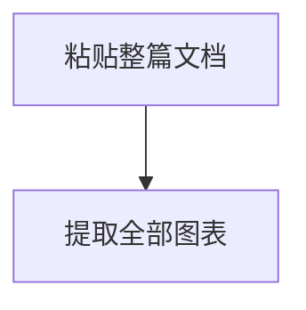

# xmermaid Live

[English](README.md) | [简体中文](README.zh-CN.md)

[](https://github.com/evangwt/xmermaid-live/actions/workflows/deploy-pages.yml)
[](https://evangwt.github.io/xmermaid-live/)
[](https://www.npmjs.com/package/@evangwt/xmermaid)
[](LICENSE)

> **粘贴整篇文档，得到全部图表 —— 而不是你自己翻找、逐个复制的那一张。**

xmermaid Live 一次遍历就自动提取文档中的**所有** Mermaid 图表 —— 围栏、未闭合、散文中的裸图表都算 —— 再逐张实时渲染，供你编辑、导出或分享。无需账号、没有服务器、不做上传。


<p>
  <a href="https://evangwt.github.io/xmermaid-live/"><strong>打开在线编辑器 →</strong></a>
  &nbsp;|&nbsp;
  <a href="https://github.com/evangwt/xmermaid"><strong>查看渲染器</strong></a>
</p>

---

## 差异所在：整篇进，全部出

多数 Mermaid 工具只是一个**单图表粘贴框**。你要滚动文本、找到一张图、复制它、粘贴它、渲染它 —— 然后为下一张再来一遍，全靠手工。只要代码块不够规整，就直接失败。

xmermaid Live 反过来做：你只粘贴**整篇**文档一次，它自己找出所有图表、列成清单，让你在它们之间来回切换。


| | 单图表粘贴工具 | **xmermaid Live** |
|---|---|---|
| **输入** | 你自己翻找并复制的那一张图 | 整篇文档，粘贴一次 |
| **提取** | 手工、逐张 | 自动 —— 一次遍历拿到全部 |
| **围栏** | 需要规整的 ```` ```mermaid ```` 块 | 容忍未闭合、`~~~`、info string、中性围栏 |
| **完全没有围栏** | 失败 | 在散文中被识别为裸图表 |
| **渲染之后** | 复制下一张，重复 | 在列表中切换图表，逐张原地编辑 |
| **图表出错时** | 空白画布，没有任何说明 | 逐图状态、诊断信息、可复制的复现源码 |

下面这段真实粘贴 —— 两张图，一张有围栏、一张没有 —— 会被识别为两张图表，按源码顺序排列，你不需要碰其中任何一张：

````markdown
这是流程：



同一条流水线，裸写、没有围栏：

flowchart LR
  Extract --> Preview --> Export
````

## 能识别什么

识别逻辑构建在渲染器的严格提取器之上，且刻意宽松 —— 因为粘贴进来的内容很少出现在规整的围栏里。它在每次按键时运行，且是线性扫描；超过 100,000 字符后，改为在你停止输入时重新扫描。

| 形式 | 示例 |
|---|---|
| 精确图表围栏 | ```` ```mermaid ```` / ```` ```xmermaid ```` / ```` ```mmd ```` |
| 波浪线围栏 | `~~~mermaid` |
| 带 info string 的围栏 | ```` ```mermaid {highlight: "1-2"} ```` |
| **未闭合围栏** | ```` ```mermaid ```` 没有结束行（一直延伸到文末） |
| 承载图表的中性围栏 | ```` ```text ```` / ```` ```md ```` / ```` ``` ```` |
| **散文中的裸图表** | 段落中间的 `flowchart TD` 行，没有围栏 |
| **引用块中的图表** | 用 `>` 标记引用的图表 —— 别人引用聊天回答时的常见形态 |
| `%%` 注释与一个 front-matter 块 | 挂到其上方的图表 |
| 多张图表 | 被散文分隔、紧挨着、或围栏/裸图混排 —— 均按源码顺序保留 |
| **一个围栏里塞多张图** | 一个 ```` ```mermaid ```` 块里装两张图时，按每个零缩进图表头拆开，两张都能渲染，而不是整块当作一张图失败 |

它同样知道**不该动什么**：```` ```js ```` 块里形似图表的行仍是代码；而仅仅"像"图表语法的散文（图注、`Title: …`、项目符号列表，或以边操作符开头的行如 `-> 见附录`）会终止裸块，而不是被吞进去。围栏拆分刻意保守 —— 拆分点必须是零缩进、且不含边操作符的图表头（所以名为 `sequenceDiagram` 的节点写成 `sequenceDiagram --> B` 时仍是节点）；若拆出的任何一段只是单独一行，则整栏保持原样。这些刻意的边界都有文档记录，并在 [`src/diagram-extract.ts`](src/diagram-extract.ts) 中有测试覆盖。

**容量：** 在验证环境中，粘贴并提取一份 1,000 张图表的文档少于 1.5 秒（有端到端测试把关）。这不是增量解析器 —— 开销随图表数量走，约 0.1 毫秒/张，因此图表密集的 1 兆字节（约 15,000 张）要数秒，而散文为主的内容便宜得多 —— 所以超过 100,000 字符的文档改为在停止输入时重新提取，而不是每次按键都跑；无论你编辑的是完整文本还是仅当前图表，都是如此（编辑单张图会先立即拼接文本、再延迟重扫描）。文本与实时预览跟手；图表列表、其计数与图文混排视图在延迟扫描落地时补齐。

## 多图表工作台，而非单画布

提取只有在工作台把文档当作"多张图表"时才真正有用。它做到了：

- **图表列表** —— 每张提取出的图表都是一个可选条目，显示序号、图表族、支持状态与源码行号。可折叠；数量显示在标题栏。
- **一个文档，两个编辑器** —— 在 **完整文本**（整篇文档，Markdown 高亮）与 **当前图表**（仅选中的那张，Mermaid 高亮）之间切换。编辑当前图表只会改写该图表在文档中的那一段，周围散文原样保留。
- **图文混排的文档预览** —— 第三个标签页按原文顺序通读整篇文档：散文渲染成排版文本，每张图表就渲染在它原本出现的位置。图表随滚动懒渲染，长文档也不吃力。
- **上一张 / 下一张导航** —— 带着 `n / 总数` 的位置读数逐张浏览，无需回到列表。
- **选择不跳动** —— 编辑过程中，选中的图表按内容匹配来跟踪，预览不会在你光标下突然跳到别的图。
- **逐图表输出** —— 导出 SVG/PNG、分享、复制复现源码，都作用于你当前选中的那张。

首次访问时，工作台会预载一份 **33 张图表的示例文档** —— 每个受支持图表族各一张，全部由它自己的渲染器绘制，其中还特意放了一张无围栏的裸图表来演示自动识别。

## 逐图表的诚实反馈

每张图表都带着真实的支持状态，失败时会自己解释原因，而不是给你一片空白：

- 列表与诊断栏报告**当前选中**图表的真实能力。
- 诊断带有代码、消息与源码范围；不支持的语法会被如实呈现，绝不静默降级成假预览。
- **复制复现源码** 把该图表的确切源码放进剪贴板，随时可以贴进 issue。
- 只有当渲染快照与当前源码**和**主题都匹配时，导出才可用 —— 绝不把过期 SVG 当作新结果交给你。

## 预览与样式

- **画布控制** —— 25%–400% 缩放、适配、全屏、最大化面板、缩略图、指针处滚轮缩放、拖拽平移。每张图表的视口单独记忆；缩放与平移绝不进入分享链接。
- **样式检查器** —— 不改源码就能重设当前图表的样式：基础主题（深/浅）、整套颜色（画布、节点填充/描边/文字、连线描边/标签、箭头填充、子图填充/描边）、曲线样式（bezier/step/straight）、箭头样式（filled/triangle/open/circle/cross）、几何（边距、箭头尺寸、节点圆角）、字体族与字号。一键重置。
- **布局随你** —— 三栏可拖拽分隔、键盘微调、列表可收起；布局本地保存。宽度低于 1024px 时切换为底部导航，分享与导出收在 **更多** 菜单中。

## 暗色主题

工作台同时提供浅色与暗色两套主题。首次访问跟随系统偏好，之后记住你的选择；切换时**整个**工作台一并变化 —— 外壳、语法高亮、图表列表，以及渲染出来的图表本身（会跟着重新渲染）。


## 架构级隐私

纯客户端。你的文档缓存在本地存储（上限 2 MB，防抖写入），可选编码进 URL hash 用于分享 —— **绝不上传到本项目或任何服务器**。分享上限为 50,000 字符的 hash；更长的文档仍可编辑导出，但不进入地址栏。导出在 WASM 中完成，不发起网络请求。清除该站点的浏览器数据即可删除缓存。

## 适合谁使用

- **开发者与文档作者**：把 AI 生成的图表粘进文档 —— 一次好几张，语法还很乱。
- **审阅聊天记录的人**：里面的图表并没有规整的围栏。
- **在意隐私的用户**：不能把内部架构上传给第三方服务。
- **发布静态文档的团队**：需要干净的 SVG/PNG 输出与可分享链接。

## 快速上手

### 30 秒试用（无需安装）

1. 打开 **[evangwt.github.io/xmermaid-live](https://evangwt.github.io/xmermaid-live/)**。
2. 粘贴一整篇文档 —— 一段 AI 回答、一个 README、一份设计文档。不要手工挑出任何图表。
3. 所有图表会出现在左侧列表中。点击任意一张即可预览、编辑与导出。

### 在本地运行

需要 **Node.js 22+**。

```bash
git clone https://github.com/evangwt/xmermaid-live.git
cd xmermaid-live
npm install
npm run dev
```

Vite 会打印一个本地地址（通常是 `http://localhost:5173`）—— 与线上演示相同的工作台。`npm run dev` 会自动把固定版本的 WASM 模块复制到 `public/`，无需 Rust 工具链。

## 图表示例

三十个受支持图表族中的十二个，全部由工具自身渲染并导出为 SVG —— 没有手绘示意图：


## 背后的渲染器

由 [`@evangwt/xmermaid`](https://github.com/evangwt/xmermaid) 驱动 —— 一个 Rust/WASM 渲染器，其机器可读矩阵覆盖 **Mermaid 11.16.0 目录（30 个有文档图表族）**。

- **完全支持：** User Journey、Gantt、Pie。
- **部分支持（有文档的子集）：** flowchart、swimlanes、sequence、class、state、ER、quadrant、requirement、gitGraph、C4、mindmap、timeline、ZenUML、sankey、xychart、block、packet、kanban、architecture、radar、event-modeling、treemap、Venn、Ishikawa、Wardley、Cynefin、treeview。

支持范围以渲染器的运行时诊断为准。完整契约见[渲染器 README](https://github.com/evangwt/xmermaid#what-renders-today)。构建固定精确版本 —— 已发布版本取自 `registry.npmjs.org`；尚未 `npm publish` 的版本可固定被 gitignore 的 `vendor/evangwt-xmermaid-<version>.tgz`。

## 本地开发

Node.js 22+；Chrome/Chromium、Firefox、WebKit 用于验证。

```bash
npm install
npx playwright install chromium firefox webkit   # 仅浏览器测试需要
npm run dev
```

### 验证

```bash
npm run verify
```

单元测试、类型检查、生产构建、真实 WASM 与浏览器检查。所有场景在 Chrome/Chromium 运行；核心编辑流程与部署冒烟也在 Firefox 和 WebKit 运行。1,000 图表的容量契约在此把关。

### 图表矩阵

```bash
npm run serve:test &
npm run test:diagrams -- --browser=chromium --runs=2
```

为每个图表族渲染一个复杂示例（`scripts/diagram-matrix/examples.mjs`）并截图预览；报告写入 `output/diagram-matrix/<browser>/`。同样运行在 CI（`.github/workflows/diagram-matrix.yml`）。`scripts/diagram-matrix/REPORT.md` 记录支持边界与已知上游缺陷。

## 部署

**GitHub Pages** —— <https://evangwt.github.io/xmermaid-live/>。`.github/workflows/deploy-pages.yml` 在每次推送到 `main` 时部署。首次部署前，将 **Settings → Pages → Build and deployment → Source** 设为 **GitHub Actions**。

**任意静态托管：**

```bash
npm run build
```

`dist/` 使用相对 URL —— 可部署在域名根路径或 `/xmermaid-live/` 等子路径。构建后无需服务器 API、Node 进程或 Rust 工具链。

**搜索与 AI 检索** —— 首页内置中英文元数据、如实描述的 SoftwareApplication 结构化数据、站点地图、爬虫规则与 `llms.txt`。

## 许可证

MIT。完整文本见 [LICENSE](LICENSE)。
